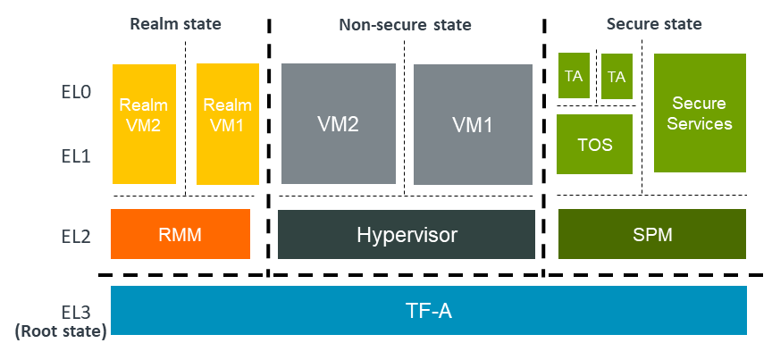

Realm Management Extension (RME)
====================================

FEAT_RME (or RME for short) is an Armv9-A extension and is one component of the
`Arm Confidential Compute Architecture (Arm CCA)`_. TF-A supports RME starting
from version 2.6. This chapter discusses the changes to TF-A to support RME and
provides instructions on how to build and run TF-A with RME.

RME support in TF-A
---------------------

The following diagram shows an Arm CCA software architecture with TF-A as the
EL3 firmware. In the Arm CCA architecture there are two additional security
states and address spaces: ``Root`` and ``Realm``. TF-A firmware runs in the
Root world. In the realm world, a Realm Management Monitor firmware (`RMM`_)
manages the execution of Realm VMs and their interaction with the hypervisor.

RME is the hardware extension to support Arm CCA. To support RME, various
changes have been introduced to TF-A. We discuss those changes below.

Changes to translation tables library
***************************************
RME adds Root and Realm Physical address spaces. To support this, two new
memory type macros, ``MT_ROOT`` and ``MT_REALM``, have been added to the
:ref:`Translation (XLAT) Tables Library`. These macros are used to configure
memory regions as Root or Realm respectively.

.. note::

 Only version 2 of the translation tables library supports the new memory
 types.

Changes to context management
*******************************
A new CPU context for the Realm world has been added. The existing can be used
to manage Realm context.

Boot flow changes
*******************
In a typical TF-A boot flow, BL2 runs at Secure-EL1. However when RME is
enabled, TF-A runs in the Root world at EL3. Therefore, the boot flow is
modified to run BL2 at EL3 when RME is enabled. In addition to this, a
Realm-world firmware (`RMM`_) is loaded by BL2 in the Realm physical address
space.

The boot flow when RME is enabled looks like the following:

1. BL1 loads and executes BL2 at EL3
2. BL2 loads images including RMM
3. BL2 transfers control to BL31
4. BL31 initializes SPM (if SPM is enabled)
5. BL31 initializes RMM
6. BL31 transfers control to Normal-world software

Security states and PAS access rights
*************************************
Arm CCA adds two new security states for a total of four: root, realm, secure,
and non-secure. In addition to new security states, corresponding physical
address spaces have been added to control memory access for each state. The PAS
access allowed to each security state can be seen in the table below.

.. list-table:: Security states and PAS access rights
   :widths: 25 25 25 25 25
   :header-rows: 1

   * -
     - Root state
     - Realm state
     - Secure state
     - Non-secure state
   * - Root PAS
     - yes
     - no
     - no
     - no
   * - Realm PAS
     - yes
     - yes
     - no
     - no
   * - Secure PAS
     - yes
     - no
     - yes
     - no
   * - Non-secure PAS
     - yes
     - yes
     - yes
     - yes

The GPT can function as either a 1 level or 2 level lookup depending on how a
PAS region is configured. The first step is the level 0 table, each entry in the
level 0 table controls access to a relatively large region in memory (GPT Block
descriptor), and the entire region can belong to a single PAS when a one step
mapping is used. Level 0 entry can also link to a level 1 table (GPT Table
descriptor) with a 2 step mapping. To change PAS of a region dynamically, the
region must be mapped in Level 1 table.

The Level 1 tables entries with the same PAS can be combined to form a
contiguous block entry using GPT Contiguous descriptor. More details about this
is explained in the following section.

RME Initialization
******************

This section covers some important concepts and data structures used in the RME
initialization.

There are three main parameters that determine how the tables are organized and
function: the PPS (protected physical space) which is the total amount of
protected physical address space in the system, PGS (physical granule size)
which is how large each level 1 granule is, and L0GPTSZ (level 0 GPT size) which
determines how much physical memory is governed by each level 0 entry. A granule
is the smallest unit of memory that can be independently assigned to a PAS.

L0GPTSZ is determined by the hardware and is read from the GPCCR_EL3 register.
PPS and PGS are passed into the APIs at runtime and can be determined in
whatever way is best for a given platform, either through some algorithm or hard
coded in the firmware.

In RME initialization, a data structure containing information about the
desired PAS regions is passed into the library which validates the mappings,
creates the tables in memory, and enables granule protection checks. In the
runtime initialization step, the runtime firmware locates the existing tables in
memory using the GPT register configuration and saves important data to a
structure used by the granule transition service which will be covered more
below.

Defining PAS regions
~~~~~~~~~~~~~~~~~~~~

A ``pas_region_t`` structure is a way to represent a physical address space and
its attributes that can be used by the GPT library to initialize the tables.

This structure is composed of the following:

#. The base physical address
#. The region size
#. The desired attributes of this memory region (mapping type, PAS type)

See the ``pas_region_t`` type in ``include/lib/extensions/rme.h``.

The programmer should provide the API with an array containing ``pas_region_t``
structures, then the library will check the desired memory access layout for
validity and create tables to implement it.

``pas_region_t`` is a public type, however it is recommended that the macros
``GPT_MAP_REGION_BLOCK`` and ``GPT_MAP_REGION_GRANULE`` be used to populate
these structures instead of doing it manually to reduce the risk of future
compatibility issues. These macros take the base physical address, region size,
and PAS type as arguments to generate the pas_region_t structure. As the names
imply, ``GPT_MAP_REGION_BLOCK`` creates a region using only L0 mapping while
``GPT_MAP_REGION_GRANULE`` creates a region using L0 and L1 mappings.

In the reference implementation for FVP models, you can find an example of PAS
region definitions in the file ``plat/arm/board/fvp/include/fvp_pas_def.h``.
Table creation API calls can be found in ``plat/arm/common/arm_common.c``.

Level 0 and Level 1 Tables
~~~~~~~~~~~~~~~~~~~~~~~~~~

The GPT initialization APIs require memory to be passed in for the tables to be
constructed. The ``rme_init_gpt_l0_tables`` API takes a memory address and size
for building the level 0 tables.

The ``rme_init_gpt_l1_tables`` API takes an address and size for
building the level 1 tables which are linked from level 0 descriptors. The
tables should have PAS type ``GPT_GPI_ROOT`` and a typical system might place
its level 0 table in SRAM and its level 1 table(s) in DRAM.

Library APIs
~~~~~~~~~~~~~~~

The public APIs and types can be found in ``include/lib/extensions/rme.h`` and
this section is intended to provide additional details and clarifications.

To create the GPTs and enable granule protection checks the APIs need to be
called in the correct order and at the correct time during the system boot
process.

#. Firmware must enable the MMU.
#. Firmware must call ``rme_init_gpt_l0_tables`` to initialize the level 0
   tables to a default state, that is, initializing all of the L0 descriptors to
   allow all accesses to all memory. The PPS is provided to this function as an
   argument.
#. DDR discovery and initialization by the system, the discovered DDR region(s)
   are then added to the L1 PAS regions to be initialized in the next step and
   used by the GTSI at runtime.
#. Firmware must call ``rme_init_gpt_l1_tables`` with a pointer to an array of
   ``pas_region_t`` structures containing the desired memory access layout. The
   PGS is provided to this function as an argument.
#. Firmware must call ``rme_gpc_enable`` to enable granule protection checks by
   setting the correct register values.
#. Firmware must call ``rme_sync_gpt_config_for_warmboot`` to sync GPT config
   from previous bootloader stage. Public API to initialize the runtime
   gpt_config structure based on the values present in the GPTBR_EL3 and
   GPCCR_EL3 registers. GPT initialization typically happens in a bootloader
   stage prior to setting up the EL3 runtime environment for the granule
   transition service so this function detects the initialization from a
   previous stage.

API Constraints
~~~~~~~~~~~~~~~

The values allowed by the API for PPS and PGS are enumerated types
defined in the file ``include/lib/extensions/rme.h``.

Allowable values for PPS along with their corresponding size.

* ``GPCCR_PPS_4GB`` (4GB protected space, 0x100000000 bytes)
* ``GPCCR_PPS_64GB`` (64GB protected space, 0x1000000000 bytes)
* ``GPCCR_PPS_1TB`` (1TB protected space, 0x10000000000 bytes)
* ``GPCCR_PPS_4TB`` (4TB protected space, 0x40000000000 bytes)
* ``GPCCR_PPS_16TB`` (16TB protected space, 0x100000000000 bytes)
* ``GPCCR_PPS_256TB`` (256TB protected space, 0x1000000000000 bytes)
* ``GPCCR_PPS_4PB`` (4PB protected space, 0x10000000000000 bytes)

Allowable values for PGS along with their corresponding size.

* ``GPCCR_PGS_4K`` (4KB granules, 0x1000 bytes)
* ``GPCCR_PGS_16K`` (16KB granules, 0x4000 bytes)
* ``GPCCR_PGS_64K`` (64KB granules, 0x10000 bytes)

Allowable values for L0GPTSZ along with the corresponding size.

* ``GPCCR_L0GPTSZ_30BITS`` (1GB regions, 0x40000000 bytes)
* ``GPCCR_L0GPTSZ_34BITS`` (16GB regions, 0x400000000 bytes)
* ``GPCCR_L0GPTSZ_36BITS`` (64GB regions, 0x1000000000 bytes)
* ``GPCCR_L0GPTSZ_39BITS`` (512GB regions, 0x8000000000 bytes)

Note that the value of the PPS, PGS, and L0GPTSZ definitions is an encoded value
corresponding to the size, not the size itself. The decoded hex representations
of the sizes have been provided for convenience.

The L0 table memory has some constraints that must be taken into account.

* The L0 table must be aligned to either the table size or 4096 bytes, whichever
  is greater. L0 table size is the total protected space (PPS) divided by the
  size of each L0 region (L0GPTSZ) multiplied by the size of each L0 descriptor
  (8 bytes). ((PPS / L0GPTSZ) * 8)
* The L0 memory must fall within a PAS of type GPT_GPI_ROOT.

The L1 memory also has some constraints.

* The L1 tables must be aligned to their size. The size of each L1 table is the
  size of each L0 region (L0GPTSZ) divided by the granule size (PGS) divided by
  the granules controlled in each byte (2). ((L0GPTSZ / PGS) / 2)
* There must be enough L1 memory supplied to build all requested L1 tables.
* The L1 memory must fall within a PAS of type GPT_GPI_ROOT.

If an invalid combination of parameters is supplied, the APIs will print an
error message and return a negative value. The return values of APIs should be
checked to ensure successful configuration.

Sample Calculation for L0 memory size and alignment
~~~~~~~~~~~~~~~~~~~~~~~~~~~~~~~~~~~~~~~~~~~~~~~~~~~

Let PPS=4GB and L0GPTSZ=GPCCR_L0GPTSZ_30BITS

We can find the total L0 table size with ((PPS / L0GPTSZ) * 8)

Substitute values to get this: ((0x100000000 / 0x40000000) * 8)

And solve to get 32 bytes. In this case, 4096 is greater than 32, so the L0
tables must be aligned to 4096 bytes.

Sample calculation for L1 table size and alignment
~~~~~~~~~~~~~~~~~~~~~~~~~~~~~~~~~~~~~~~~~~~~~~~~~~

Let PGS=GPCCR_PGS_4K and L0GPTSZ=GPCCR_L0GPTSZ_30BITS

We can find the size of each L1 table with ((L0GPTSZ / PGS) / 2).

Substitute values: ((0x40000000 / 0x1000) / 2)

And solve to get 0x20000 bytes per L1 table.

Granule Protection Tables (GPT) library
***************************************
This is the runtime component of BL31 that is responsible to transition the PAS
of a granule. GPT library in BL31 runtime component provides provides APIs to
transition granules between different physical address spaces has been added.
More information about the GPT library can be found in the
:ref:`Granule Protection Tables Library` chapter.

RMM Dispatcher (RMMD)
************************
RMMD is a new standard runtime service that handles the switch to the Realm
world. It initializes the `RMM`_ and handles Realm Management Interface (RMI)
SMC calls from Non-secure.

There is a contract between `RMM`_ and RMMD that defines the arguments that the
former needs to take in order to initialize and also the possible return values.
This contract is defined in the `RMM`_ Boot Interface, which can be found at
:ref:`rmm_el3_boot_interface`.

There is also a specification of the runtime services provided by TF-A
to `RMM`_. This can be found at :ref:`runtime_services_and_interface`.

Test Realm Payload (TRP)
*************************
TRP is a small test payload that runs at R-EL2 and implements a subset of
the Realm Management Interface (RMI) commands to primarily test EL3 firmware
and the interface between R-EL2 and EL3. When building TF-A with RME enabled,
if the path to an RMM image is not provided, TF-A builds the TRP by default
and uses it as the R-EL2 payload.

Building and running TF-A with RME
----------------------------------

The recommended procedure for building and running an RME enabled reference
platform is by the use of `Shrinkwrap`_.

The tool offers examples of Three-worlds and Four-worlds configurations for
running on the *FVP_Base_RevC-2xAEMvA* model.

- Three-world execution: this is the configuration to use if Secure
  world functionality is not needed.

- Four-world execution: this is the configuration to use if both Secure
  and Realm world functionality is needed.

TF-A is tested with the following software entities in each world as listed below:

  - NS Host (RME capable Linux),
  - EL3 Root (TF-A)
  - R-EL2 (`RMM`_)
  - S-EL2 (`SPM`_ / Hafnium) in a 4-worlds configuration

Additionally, the TF-RMM project documentation has the specific `Shrinkwrap guide`_.

TF-A CI pipeline includes coverage for building TF-A along with TF-RMM and SPM/Hafnium
for running 3 worlds and 4 worlds configurations. In those cases, the normal world payload
and test suite originates from TF-a-tests project.

.. _Arm Confidential Compute Architecture (Arm CCA): https://www.arm.com/why-arm/architecture/security-features/arm-confidential-compute-architecture
.. _SPM: https://www.trustedfirmware.org/projects/hafnium/
.. _RMM: https://www.trustedfirmware.org/projects/tf-rmm/
.. _Shrinkwrap: https://shrinkwrap.docs.arm.com/en/latest/
.. _Shrinkwrap guide: https://tf-rmm.readthedocs.io/en/latest/getting_started/building-with-shrinkwrap.html
